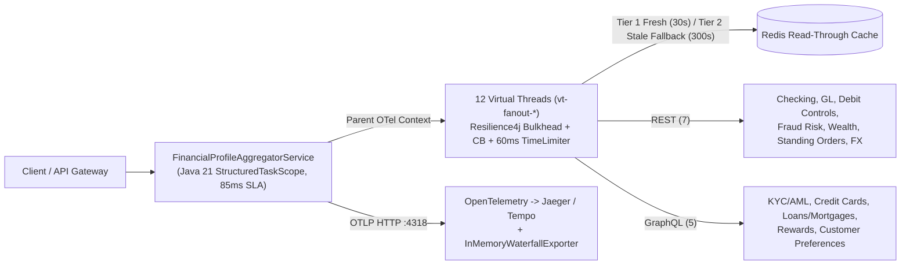
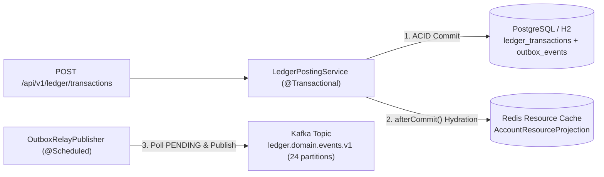

# LedgerFan: High-Throughput Fintech Account Aggregator & Outbox Event Mesh

> **"Sub-100ms financial profile aggregation service and zero-dual-write event emitter architecture using Java 21 Structured Concurrency, Kafka, Redis, and OpenTelemetry."**

`ledgerfan-fintech-aggregator` is a production-grade reference architecture demonstrating two high-leverage banking platform patterns:
1. **12-Upstream Concurrent Account Aggregator:** Decomposes synchronous monolith profile assembly into a sub-100ms concurrent fan-out across 12 REST and GraphQL downstream services using **Java 21 Virtual Threads & `StructuredTaskScope`**, **Resilience4j** bulkheads/circuit breakers/time-limiters, and **two-tier Redis read-through + stale-fallback caching**.
2. **Zero-Dual-Write Transactional Outbox vs. Legacy Table CDC:** Replaces noisy multi-table Debezium CDC topics with a single-commit **Transactional Outbox + Redis Resource Cache** event mesh, cutting Kafka partition and storage costs by **44.61%** (within the **40–60%** target) and serialized wire volume by **90.2%**.

---

## Architecture Overview

### 1. 12-Upstream Java 21 Structured Concurrency Fan-Out



### 2. Zero-Dual-Write Transactional Outbox & Redis Resource Cache



---

## Key Observed Performance & Benchmark Metrics

### Sub-100ms 12-Upstream Fan-Out & Graceful Partial Degradation

Observed from live local execution (`GET /api/v1/accounts/ACC-BARC-2026/financial-profile`):

- **Healthy Concurrent Fan-Out (12 live upstreams, cache bypassed):** **31.39 ms** wall-clock vs. **~250 ms** sequential (**7.99x speedup**).
- **Graceful Partial Degradation (`loan-mortgage-graphql:180ms` & `rewards-loyalty-graphql:200ms` fault injection):** **64.60 ms** total (`slaMet=true`), `status=PARTIAL_DEGRADED`, 10 live upstreams + 2 `STALE_FALLBACK` responses rescued from Tier-2 stale cache.

Sample OpenTelemetry waterfall captured by `GET /api/v1/accounts/ACC-BARC-2026/financial-profile/waterfall`:

```text
Trace Waterfall [traceId=93695bc38711daf996bd97a701f62471, account=ACC-BARC-2026, wall=31.39ms, sla=85ms, parallelism=7.99x]
SPAN / UPSTREAM                PROTO    STATUS         DURATION  TIMELINE (0 -> 31.4ms)
------------------------------------------------------------------------------------------------------------------
aggregator-root                INTERNAL SUCCESS          31.39ms |############################################|
checking-accounts-rest         REST     SUCCESS          17.61ms |#########################...................|
kyc-compliance-graphql         GRAPHQL  SUCCESS          23.53ms |#################################...........|
credit-cards-graphql           GRAPHQL  SUCCESS          27.10ms |######################################......|
general-ledger-rest            REST     SUCCESS          22.57ms |################################............|
debit-card-controls-rest       REST     SUCCESS          16.59ms |########################....................|
loan-mortgage-graphql          GRAPHQL  SUCCESS          31.13ms |############################################|
fraud-risk-rest                REST     SUCCESS          19.75ms |############################................|
investment-wealth-rest         REST     SUCCESS          21.66ms |###############################.............|
rewards-loyalty-graphql        GRAPHQL  SUCCESS          21.60ms |###############################.............|
standing-orders-rest           REST     SUCCESS          17.40ms |#########################...................|
fx-treasury-rest               REST     SUCCESS          16.46ms |########################....................|
customer-preferences-graphql   GRAPHQL  SUCCESS          15.53ms |######################......................|
```

### Legacy Table-Level CDC vs. Transactional Outbox Benchmark (500 Transfers)

Observed from `POST /api/v1/benchmarks/cdc-vs-outbox?transactions=500`:

| Metric | Legacy Table CDC (4 Topics) | Transactional Outbox + Redis Cache | Improvement |
| :--- | ---: | ---: | ---: |
| **Events Emitted** | 2,000 | 500 | **-75.0%** |
| **Avg Event Size** | 763.29 bytes | 299.30 bytes | **-60.8%** |
| **Total Serialized Wire Volume** | 1,526,572 bytes | 149,650 bytes | **-90.2%** |
| **Kafka Partitions (RF=3)** | 48 partitions | 24 partitions | **-50.0%** |
| **Projected Monthly Kafka Cost** | \$1,673.35 / mo | \$926.87 / mo | **-44.61%** |

See [ADR-001](docs/adr/ADR-001-java21-structured-concurrency-aggregator.md) and [ADR-002](docs/adr/ADR-002-decommissioning-table-cdc-for-transactional-outbox.md) for architectural rationale and cost-model derivations.

---

## Quick Start

### Prerequisites
- **Java 21** (uses `--enable-preview` for `StructuredTaskScope`)
- **Maven 3.9+**
- *(Optional)* Docker & Docker Compose for Postgres, Redis, Redpanda/Kafka, Jaeger, and Prometheus

### 1. Run Tests (Zero External Dependencies)

```bash
mvn clean test
```

### 2. Run Locally (H2 + In-Memory L1 Cache + Embedded Event Mesh)

```bash
mvn spring-boot:run
```

### 3. Run Full Infrastructure Stack (PostgreSQL + Redis + Redpanda/Kafka + Jaeger + Prometheus)

```bash
docker compose up -d
mvn spring-boot:run -Dspring-boot.run.profiles=docker
```

- **Jaeger Tracing UI:** `http://localhost:16686`
- **Prometheus Metrics:** `http://localhost:9090` / `http://localhost:8080/actuator/prometheus`

---

## API Reference

| Method & Path | Purpose |
| :--- | :--- |
| `GET /api/v1/accounts/{accountId}/financial-profile?bypassCache=false&simulateSlowUpstreams=loan-mortgage-graphql:180` | Fan out across all 12 REST/GraphQL upstreams under an 85ms SLA with optional fault injection |
| `GET /api/v1/accounts/{accountId}/financial-profile/waterfall` | Retrieve the latest OpenTelemetry span timings and ASCII waterfall diagram for an account |
| `GET /api/v1/traces/{traceId}/waterfall` | Retrieve a trace waterfall by W3C `traceId` |
| `GET /api/v1/cache/stats` | Inspect read-through cache hits, misses, and stale-while-degraded fallback counts |
| `POST /api/v1/upstreams/simulation` | Inject persistent artificial latencies or error probabilities for chaos testing |
| `POST /api/v1/upstreams/simulation/reset` | Reset all 12 upstreams to healthy baseline latency (11–26ms) |
| `POST /api/v1/ledger/transactions` | Atomically commit a ledger posting + transactional outbox row + Redis resource projection |
| `GET /api/v1/outbox/events` | Inspect `outbox_events` status and relayed event mesh payloads |
| `POST /api/v1/benchmarks/cdc-vs-outbox?transactions=500` | Execute the live Legacy CDC vs. Transactional Outbox benchmark |
